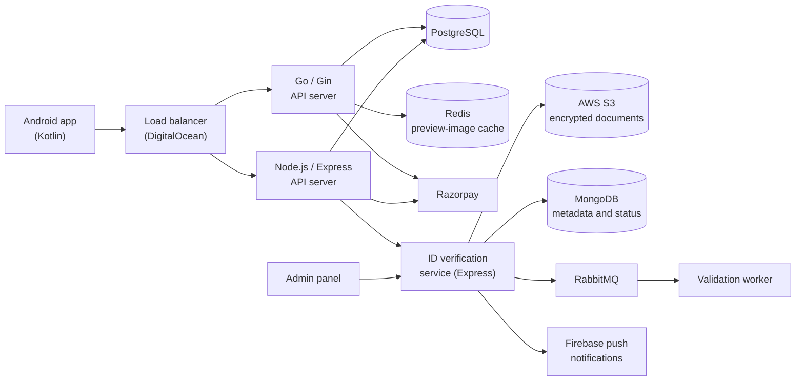

# Camps: Platform Architecture

> A student innovation network for college communities. Students discover and attend campus events, share and earn from study materials, find project collaborators and recover lost items. Colleges and event hosts get a separate organizer mode.

**Camps is currently in closed beta (about 110 testers).** The public Play Store listing is under review. Incubation was approved at the Tagore Centre for Green Technology Business Incubation (TCGTBI), IIEST Shibpur.

The production code is private. This repository documents how the system is built and what I built in it. It contains no source code, credentials or user data.

---

## At a glance

| | |
|---|---|
| **Backend** | Two REST API servers running side by side: Go (Gin) and Node.js (Express), with load-balancer failover |
| **API surface** | 50+ REST endpoints: auth, events, materials marketplace, chat, lost & found, profile and verification, organizer mode, payments |
| **Data** | PostgreSQL (core app), MongoDB (ID verification records), Redis (cache), AWS S3 (document storage) |
| **Async and messaging** | RabbitMQ queue with a worker process, Firebase push notifications |
| **Payments** | Razorpay checkout and UPI payouts |
| **Hosting** | DigitalOcean |
| **Mobile app** | Kotlin / Android (built by my co-founder) |

---

## My role

Co-founder, product and backend. I co-founded Camps with one other founder and we work as equal partners.

- Designed the whole app and website in Figma, and built the landing page.
- Designed the dual-backend architecture. I built the Express server on my own and co-built the Go server.
- Designed and built the 50+ REST APIs, tested them in Postman, and deployed both servers.
- Built the college ID verification system and its admin panel on my own.
- Built the backend of the link-sharing system on my own, in Go.
- Integrated Razorpay payments and UPI payouts.
- Ran the 800-student market survey, pitched at four college events, and presented to investors.

---

## Architecture

**Redundancy.** The Go and Express servers expose the same API behind one load balancer. If one server fails, the other keeps the app running. I tested this by stopping the Express server. A teammate set up the load balancer.

**Consistency across two backends.** Running two servers meant keeping them interchangeable. I reconciled shared PostgreSQL tables between them and standardized route and API naming, so a single frontend works against either server.

---

## Systems I built

### 1. College ID verification

Students upload a college ID on first login. An admin reviews it, and the student gets a push notification of approval or rejection. Approval unlocks the rest of the app.

- Uploads pass file validation, including checks on the real file type, before they reach storage.
- Images go to a private, encrypted S3 bucket. MongoDB stores only metadata and verification status.
- Admins view documents through short-lived pre-signed URLs. Documents are never public.
- Documents are deleted automatically from both S3 and MongoDB after a fixed retention period.
- A RabbitMQ queue and a separate worker process handle upload validation, with retries and a dead-letter queue.
- A consistency checker finds database records without files and files without records.
- The pipeline is a standalone service with a pluggable verification stage. It currently runs on manual admin review.

### 2. Admin panel

A mobile-first panel for reviewing verification requests. Built with vanilla JavaScript, Vite and Tailwind CSS.

- JWT login with expiring sessions.
- Approve or reject with a reason, with status filters and infinite scroll.
- Optimistic locking, so two admins cannot process the same document. The second admin gets a clear "already processed" response.
- Document images load lazily and refresh automatically when a pre-signed URL expires.
- Unit tests with Vitest.

### 3. Link sharing (backend)

Events, event merchandise, notes, lost & found, projects and files can all be shared as links.

- Each link opens a server-rendered page with Open Graph metadata, so messaging apps show a preview card.
- Preview images (1200×630) are drawn on the server with the Camps logo and the item's details, and cached in Redis. They refresh when the item is edited.
- A shared link opens the app if it is installed, and otherwise goes to the Play Store page.
- Access rules: if a recipient cannot see an item, they land on its parent page. If the item was deleted, they see a clear "page deleted" message.
- Status: built and tested locally, including on a phone. It ships with the public Play Store listing.

### 4. Payments

Razorpay checkout for tickets, merchandise and add-ons, and UPI payouts to students who contribute study materials. The founders tested payments and payouts with real transactions. They have not yet been used at a live event.

---

## Security design

| Layer | What is in place |
|---|---|
| Authentication | JWT across both servers, Google sign-in, bcrypt password hashing |
| Service-to-service | Timing-safe API-key checks for app-to-server, admin-to-server and service-to-server calls |
| Abuse protection | Per-IP rate limiting, request sanitization, Helmet security headers, CORS rules |
| Storage | Private encrypted S3 bucket, least-privilege IAM, pre-signed URLs only |
| Data lifecycle | Automatic deletion of ID documents after a retention period |
| Logging | Structured logs with credential redaction, request IDs, audit events |

---

## Product and business work

- Surveyed 800 students across colleges, and used the results to prioritize Lost & Found and drop features that did not fit (such as voice and video calling).
- Pitched at four college events, at the idea stage with no product to demo.
- Won verbal launch commitments from several partner colleges.
- Proposed the revenue model, revised it after investor feedback, and finalized it with my co-founder.
- Acted on beta-tester feedback: redesigned the login screen in Figma and fixed backend search bugs.

---

## Also in Camps (built by teammates)

I did not build these, and I list them so the picture of the product is complete.

- **Android app (Kotlin):** my co-founder.
- **Recommendation engine:** a hybrid event recommender (semantic retrieval with sentence embeddings and FAISS, plus a LightGBM ranker), built by a developer on the team.
- **Load-balancer setup:** a teammate.

---

## Tech stack

Go (Gin) · Node.js (Express) · PostgreSQL · MongoDB · Redis · RabbitMQ · AWS S3 and IAM · Firebase (push notifications) · Razorpay · DigitalOcean · JWT · Google OAuth · Postman · Git/GitHub · Figma · Canva · HTML, CSS, JavaScript, React (landing page)

---

## Contact

Arpan Chatterjee · [LinkedIn](https://linkedin.com/in/arpan-chatterjee-b07076325) · [GitHub](https://github.com/Zes-Ar) · arpanchatterjee0101@gmail.com

*Private code, public documentation: details of the codebase can be discussed in an interview.*
